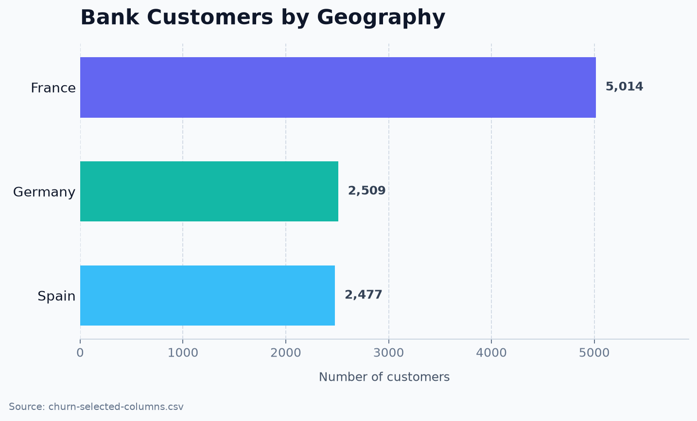

# Bank Customer Churn Analysis

A Python project for exploring bank customer data through summary statistics, geography counts, distributions, correlations, and churn breakdowns.



## Interactive dashboard

The dashboard uses an aggregate-only summary generated from the CSV. It does not show names, customer IDs, or individual records. To open it locally, start a small web server in this folder:

```bash
python -m http.server 8000
```

Then visit `http://localhost:8000` in your browser. The dashboard loads `dashboard-data.json`; the geography chart image is `geography_customers.png`. Use **Upload data** to summarize another CSV in your browser. Uploaded data is not sent to a server, and the dashboard displays aggregated statistics only.

The included CSV does not have an `Exited` column, so churn is not available for this dataset.

When GitHub Pages is enabled, the dashboard will be available at:

https://thirunavukkarasushanmugam51-sketch.github.io/bank-churn-analysis/

## Project files

- `bank_analaysis.py` — main analysis script.
- `churn-selected-columns.csv` — dataset read by the script.
- `geography_customers.png` — customer count chart by geography.
- `dashboard-data.json` — aggregate-only statistics used by the dashboard.
- `index.html`, `styles.css`, and `app.js` — interactive analytics website.

## Requirements

- Python 3
- pandas
- matplotlib

Install the Python dependencies:

```bash
python -m pip install pandas matplotlib
```

## Run

Keep the CSV in the same directory as the script, then run:

```bash
python bank_analaysis.py
```

The script prints summary information and opens charts for the available columns. If the dataset contains an `Exited` column, it also prints and charts churn counts and average age by churn status.

## Data note

The CSV may contain customer-level and financial data. Share it publicly only if you have verified that it is synthetic or explicitly cleared for public distribution.
